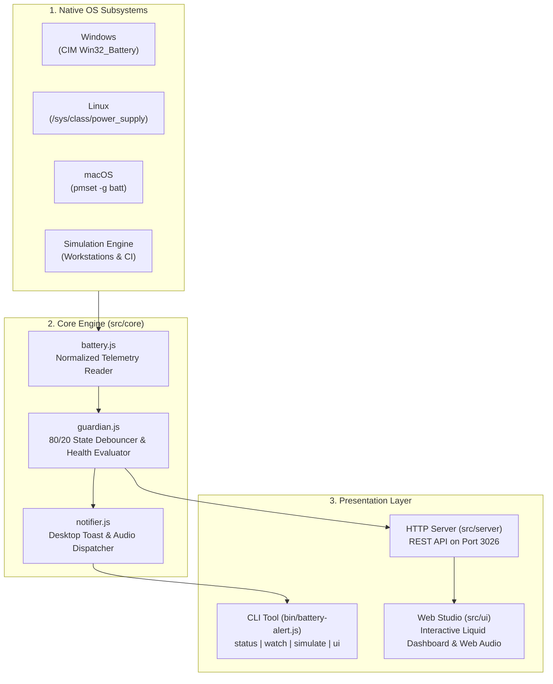

# BatteryHealth-Alert 🔋⚡

> Zero-dependency smart battery telemetry monitor, 80/20 lifespan health guardian, and charger alarm notifier with cross-platform OS detection and an interactive Web Studio.

[](https://opensource.org/licenses/MIT)
[](https://nodejs.org/)
[](package.json)
[](test)
[](http://localhost:3026)

---

## 🌟 Overview

**BatteryHealth-Alert** is a developer tool and background guardian designed to maximize laptop battery longevity and prevent thermal degradation by enforcing the **80/20 rule of lithium-ion chemistry**.

Built strictly with **pure Node.js standard libraries** (`child_process`, `os`, `fs`, `http`, `path`, `node:test`), it requires **zero external npm packages** while communicating directly with native OS power subsystems (PowerShell CIM on Windows, `/sys/class/power_supply` on Linux, `pmset` on macOS) to deliver real-time telemetry, desktop toast notifications, and a browser-based Web Studio dashboard.

---

## 🔬 The 80/20 Battery Longevity Principle

Modern lithium-ion laptop batteries experience the highest chemical stress at extreme charge states:
1. **Above 80% (High Voltage Stress):** Prolonged exposure to 100% trickle-charging accelerates electrolyte oxidation and cathode cracking, substantially reducing usable cycle life.
2. **Below 20% (Deep Discharge Stress):** Discharging down to 0% causes mechanical strain on the anode and risks permanent copper shunting.

By alerting users to **unplug at 80%** and **plug in at 20%**, **BatteryHealth-Alert** keeps battery cells within their optimal electrochemical sweet spot, tripling battery lifespan over years of daily developer workloads.

---

## 🚀 Key Features

- 🔋 **Zero-Dependency Native Telemetry**:
  - **Windows**: Queries `Win32_Battery` and `root\WMI:BatteryStatus` directly via PowerShell CIM for exact charge percentage, AC connection status, and remaining runtime.
  - **Linux**: Reads kernel `/sys/class/power_supply/BAT*` interfaces for status, design energy, and real-time capacity.
  - **macOS**: Parses `pmset -g batt` output with sub-second responsiveness.

- 🛡️ **Debounced 80/20 Guardian Engine**:
  - Automatically identifies overcharge risks (`>= 80%` while on AC power) and deep discharge risks (`<= 20%` on battery).
  - Employs state-transition debouncing to eliminate repetitive notification spam.

- 🔔 **Native Cross-Platform Notifications**:
  - Dispatches native OS desktop toast notifications (Windows Action Center, macOS Notifications, Linux `notify-send`) and audible terminal alert bells without third-party libraries.

- 🧪 **Interactive Simulation Sandbox**:
  - Includes a built-in simulation mode so developers on desktop workstations or CI containers can test threshold alerts and audio alarms without physical battery hardware.

- 🖥️ **Interactive Web Studio**:
  - Dark cinematic dashboard served on **Port 3026**.
  - Animated liquid battery fill with wave physics and live charging lightning animation.
  - Synthetic dual-frequency audio tone buzzer via Web Audio API.
  - Live threshold adjustment sliders and simulation controls.

---

## 🏗️ Architecture



---

## 📦 Installation & Setup

Clone the repository and run directly with Node.js 18+:

```bash
# Clone the repository
git clone https://github.com/mahdyarmonfared/battery-health-alert.git
cd battery-health-alert

# Verify zero external dependencies (no npm install required!)
node bin/battery-alert.js --help
```

To link globally as a system CLI command:

```bash
npm link
# Now you can run `battery-alert` from any terminal
battery-alert --version
```

---

## 💻 CLI Usage & Commands

```
  ____        _   _                   _   _            _ _   
 | __ )  __ _| |_| |_ ___ _ __ _   _ | | | | ___  __ _| | |_| |__  
 |  _ \ / _` | __| __/ _ \ '__| | | || |_| |/ _ \/ _` | | __| '_ \ 
 | |_) | (_| | |_| |_  __/ |  | |_| ||  _  |  __/ (_| | | |_| | | |
 |____/ \__,_|\__|\__\___|_|   \__, ||_| |_|\___|\__,_|_|\__|_| |_|
                               |___/                               
   Zero-Dependency Smart Battery Telemetry & 80/20 Longevity Guardian

 Usage: battery-alert [command] [options]

 Commands:
   status [opts]           Show current battery telemetry & 80/20 assessment (default)
   watch [opts]            Monitor battery in background with native alerts & audio
   simulate <percent>     Simulate a battery charge percentage to test alerts
   ui                      Launch interactive Web Studio dashboard (Port 3026)
   version                 Show BatteryHealth-Alert version
   help                    Display this help message

 Options:
   --max <n>               High charge threshold alert (default: 80%)
   --min <n>               Low charge threshold alert (default: 20%)
   --critical <n>          Critical low battery alert (default: 10%)
   -i, --interval <sec>    Polling frequency in seconds for watch (default: 5)
   -s, --simulate          Force simulation mode (useful on desktop workstations)
   --json                  Output raw machine-readable JSON telemetry
   -p, --port <n>          Port for Web Studio dashboard (default: 3026)
```

### CLI Examples

#### 1. Print instant battery telemetry:
```bash
node bin/battery-alert.js
```

#### 2. Run continuous watcher with custom 85/25 thresholds:
```bash
node bin/battery-alert.js watch --max 85 --min 25 --interval 10
```

#### 3. Test 82% overcharge alert on desktop PC:
```bash
node bin/battery-alert.js simulate 82
```

#### 4. Launch the Web Studio dashboard:
```bash
node bin/battery-alert.js ui --port 3026
```

---

## 🖥️ Interactive Web Studio

Launch the built-in Web Studio by running:

```bash
npm start
# or: node bin/battery-alert.js ui
```

Then visit **`http://localhost:3026`** in your browser.

### Web Studio Highlights:
- **Glowing Fluid Battery Visual**: Smooth CSS wave animation reflecting real-time charge levels.
- **Lightning Bolt Status**: Displays active charging animation when connected to AC power.
- **80/20 Longevity Banner**: Real-time advice and recommendations color-coded by urgency.
- **Synthetic Web Audio Alarms**: Built-in dual-tone frequency generator without external audio files.
- **Telemetry Sandbox**: Experiment with simulated battery states and test threshold triggers directly from the browser.

---

## 📡 REST API Reference

The embedded Web Studio server provides REST endpoints on port 3026:

### `GET /api/battery`
Fetches real-time battery status and 80/20 assessment.
```json
// Query Params: ?simulate=true (optional)
// Response
{
  "success": true,
  "status": {
    "hasBattery": true,
    "isSimulated": false,
    "percent": 82,
    "isCharging": true,
    "isAcConnected": true,
    "state": "charging",
    "timeRemainingMin": null,
    "healthPercent": 94,
    "os": "win32",
    "timestamp": "2026-10-18T19:50:00.000Z"
  },
  "assessment": {
    "status": "unplug_recommended",
    "type": "OVERCHARGE_RISK",
    "level": "warning",
    "message": "Target reached: 82%! Unplug charger to preserve battery longevity.",
    "recommendation": "Unplug your charger to prevent electrolyte degradation and high-voltage stress.",
    "alertTriggered": true
  }
}
```

### `POST /api/thresholds`
Updates alert thresholds on the fly.
```json
// Request Body
{
  "max": 85,
  "min": 25,
  "critical": 12
}
```

### `POST /api/simulate`
Updates simulated battery charge level.
```json
// Request Body
{
  "percent": 15,
  "isCharging": false
}
```

### `POST /api/test-alert`
Dispatches a desktop notification and audio alert test.
```json
// Request Body
{
  "title": "Battery Alert Test",
  "message": "80/20 battery health notification test."
}
```

---

## 🧪 Test Suite

Run the full automated test suite using Node.js's native test runner:

```bash
npm test
```

### Test Coverage Highlights:
- **`test/battery.test.js`**: Telemetry structure validation, forced simulation mode, dynamic state updates, boundary cap and wrap handling.
- **`test/guardian.test.js`**: Normal range evaluation, overcharge detection (80%+), deep discharge detection (20%-), critical low alert (10%-), alert debouncing logic, threshold reconfiguration.
- **`test/notifier.test.js`**: Cross-platform desktop notification execution safety, terminal audio bell invocation.
- **`test/server.test.js`**: REST API endpoints, CORS preflight, static asset serving, and path-traversal security verification.

---

## 📁 Repository Structure

```
battery-health-alert/
├── bin/
│   └── battery-alert.js       # Executable CLI binary entrypoint
├── src/
│   ├── cli/
│   │   ├── ansi.js            # Zero-dependency ANSI formatting & battery meters
│   │   └── runner.js          # CLI argument parser and command execution
│   ├── core/
│   │   ├── battery.js         # Cross-platform telemetry reader & simulator
│   │   ├── guardian.js        # 80/20 battery health evaluator & debouncer
│   │   ├── index.js           # Core module aggregator
│   │   └── notifier.js        # Native desktop notification & audio dispatcher
│   ├── server/
│   │   └── server.js          # REST API server & static file security
│   └── ui/
│       ├── app.js             # Web Studio client state & Web Audio synth
│       ├── index.html         # Web Studio dark cinematic liquid UI
│       └── style.css          # Fluid battery animation & responsive styling
├── test/
│   ├── battery.test.js        # Telemetry module tests
│   ├── guardian.test.js       # 80/20 evaluator tests
│   ├── notifier.test.js       # Notification tests
│   └── server.test.js         # REST API & security tests
├── .gitignore
├── LICENSE                    # MIT License
├── package.json
└── README.md
```

---

## 📄 License

This project is licensed under the **MIT License** - see the [LICENSE](LICENSE) file for details.

Developed with precision by **[Mahdyar Monfared](https://github.com/mahdyarmonfared)**.
